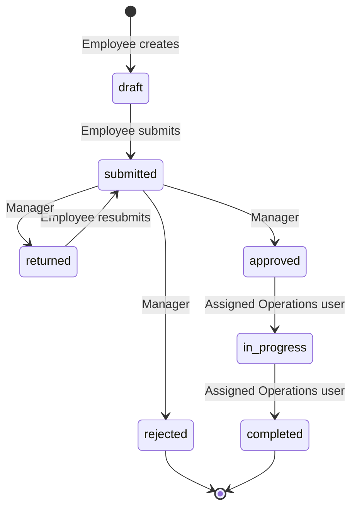

# Quantix Service API

A REST API for an internal **service request workflow**, built with Laravel 13 for the Quantix Global Software Engineering Internship take-home assignment.

Employees raise service requests (equipment, access, IT support, ...), their manager reviews them, and the Operations team assigns, performs and completes the work. Every status change is permission-checked, validated against a state machine, recorded in an audit trail, and announced to the next responsible people through queued database notifications.

---

## Table of Contents

1. [Main Features](#main-features)
2. [Technologies](#technologies)
3. [Requirements](#requirements)
4. [Installation](#installation)
5. [Environment Configuration](#environment-configuration)
6. [Database Setup](#database-setup)
7. [Running the Application](#running-the-application)
8. [Running the Queue Worker](#running-the-queue-worker)
9. [Running the Tests](#running-the-tests)
10. [API Testing with cURL](#api-testing-with-curl)
11. [End-to-End Workflow Script](#end-to-end-workflow-script)
12. [Demo Accounts](#demo-accounts)
13. [API Endpoints](#api-endpoints)
14. [Role-Based Permissions](#role-based-permissions)
15. [Request Status Workflow](#request-status-workflow)
16. [Response & Error Format](#response--error-format)
17. [Assumptions](#assumptions)
18. [Future Improvements](#future-improvements)

More detail: [`docs/ARCHITECTURE.md`](docs/ARCHITECTURE.md) · AI usage disclosure: [`docs/AI_USAGE.md`](docs/AI_USAGE.md)

---

## Main Features

- **Token authentication** with Laravel Sanctum (login, logout, current user).
- **Three roles**: Employee, Manager, Operations, with a manager hierarchy (`users.manager_id`).
- **Service request lifecycle**: create draft → edit → submit → approve / reject / return → assign → start → complete.
- **State machine** in `RequestWorkflowService` that rejects invalid status transitions.
- **Authorization policy** (`ServiceRequestPolicy`) enforcing ownership, reporting line, role and current status.
- **Role-scoped listing** with search (title, description, category, case-insensitive), status filter, sorting and pagination.
- **Comments** on requests by the owner, the owner's manager or the assigned Operations user.
- **Activity history (audit trail)** for creation, status changes and assignments.
- **Queued database notifications** to the next responsible users.
- **Row locking + DB transactions** for status changes and assignment, to avoid race conditions.
- **Consistent JSON error responses** for validation, authentication, authorization and not-found errors.
- **Feature test suite** (PHPUnit) covering the workflow, permissions, invalid transitions, notifications and listing.

## Technologies

| Component | Version / Package |
|---|---|
| Language | PHP 8.3+ |
| Framework | Laravel 13 |
| Authentication | Laravel Sanctum 4 (personal access tokens) |
| Database | PostgreSQL (development); SQLite in-memory for tests |
| Queue | Laravel database queue driver |
| Testing | PHPUnit 12 |
| Code style | Laravel Pint |

## Requirements

- PHP **8.3** or newer with extensions: `pdo_pgsql` (or `pdo_sqlite`), `mbstring`, `openssl`, `tokenizer`, `xml`, `ctype`, `json`
- Composer 2
- PostgreSQL 14+ (any database supported by Laravel should work; PostgreSQL is what was used during development)
- `pdo_sqlite` for running the automated tests

No Node.js / frontend build is required — this is an API-only application.

## Installation

```bash
# 1. Extract the project (or clone the repository) and enter it
cd quantix-service-api

# 2. Install PHP dependencies
composer install

# 3. Create the environment file and application key
cp .env.example .env
php artisan key:generate
```

## Environment Configuration

Edit `.env` and set your database credentials. The relevant keys (already present in `.env.example`):

```dotenv
APP_NAME="Quantix Service API"
APP_ENV=local
APP_DEBUG=true            # set to false in production (hides stack traces)
APP_URL=http://localhost:8000

DB_CONNECTION=pgsql
DB_HOST=127.0.0.1
DB_PORT=5432
DB_DATABASE=quantix_service_db
DB_USERNAME=quantix_user
DB_PASSWORD=your_password

QUEUE_CONNECTION=database # notifications are queued in the `jobs` table
CACHE_STORE=file
SESSION_DRIVER=file
```

> The `cache` and `sessions` tables are intentionally removed by a migration (the API is stateless), so `CACHE_STORE` and `SESSION_DRIVER` must **not** be set to `database`.

## Database Setup

Create the database and user (PostgreSQL example):

```sql
CREATE USER quantix_user WITH PASSWORD 'your_password';
CREATE DATABASE quantix_service_db OWNER quantix_user;
```

Run the migrations and load the demo data:

```bash
php artisan migrate --seed
```

To rebuild a **development** database from scratch (⚠️ deletes all data):

```bash
php artisan migrate:fresh --seed
```

### Tables

| Table | Purpose |
|---|---|
| `users` | Users with `role` (`employee` / `manager` / `operations`) and `manager_id` |
| `service_requests` | Requests: title, description, category, status, `employee_id`, `assigned_to`, `submitted_at`, `completed_at` |
| `request_comments` | Comments on requests |
| `request_activities` | Audit trail: action, from/to status, actor, comment |
| `personal_access_tokens` | Sanctum API tokens |
| `notifications` | Stored database notifications |
| `jobs`, `job_batches`, `failed_jobs` | Queue tables |

## Running the Application

```bash
php artisan serve --host=127.0.0.1 --port=8000
```

The API is available at `http://127.0.0.1:8000/api`. Check that it is up:

```bash
curl -i http://127.0.0.1:8000/up
```

Always send `Accept: application/json`, and for protected routes `Authorization: Bearer <token>`.

## Running the Queue Worker

Workflow notifications implement `ShouldQueue`. They are written to the `jobs` table and only stored in `notifications` once a worker processes them. Run in a second terminal:

```bash
php artisan queue:work
```

Check failed jobs with `php artisan queue:failed`.

## Running the Tests

Tests use an in-memory SQLite database (configured in `phpunit.xml`), so they never touch your development database.

```bash
php artisan test
```

The suite (`tests/Feature/ServiceRequestWorkflowTest.php`) has 26 tests covering the full workflow, role permissions, invalid transitions, notifications, search, filtering, sorting and pagination.

Run a single test or a group by name:

```bash
php artisan test --filter=test_manager_can_approve_direct_report_request
php artisan test --filter=notification
```

Code style check:

```bash
vendor/bin/pint --test
```

## API Testing with cURL

[`docs/API_TESTING.md`](docs/API_TESTING.md) contains ready-to-run cURL commands for every endpoint: authentication, the employee, manager and Operations workflows, search and pagination, and negative tests (401 / 403 / 422) with the expected status code for each.

Requirements: `curl`, and `jq` to save tokens and ids into shell variables.

1. Start the server (see [Running the Application](#running-the-application)).
2. In another terminal, set the base URL and enter the demo password (it is not echoed or saved):

   ```bash
   BASE_URL="http://127.0.0.1:8000"
   read -rsp "Demo password: " DEMO_PASSWORD; echo
   export DEMO_PASSWORD
   ```

3. Follow the guide section by section in the same terminal. Tokens are stored in shell variables (`EMPLOYEE_TOKEN`, `MANAGER_TOKEN`, `OPERATIONS_TOKEN`, ...) and sent as `Authorization: Bearer $EMPLOYEE_TOKEN`.

Running the whole guide once creates three service requests. The negative tests use seeded requests that the API refuses to change.

## End-to-End Workflow Script

[`docs/scripts/test-workflow.sh`](docs/scripts/test-workflow.sh) runs the complete lifecycle against a running server and stops at the first unexpected HTTP status:

employee creates → employee submits → manager approves → Operations assigns to a second Operations user → assignee starts → assignee completes → activity history (6 entries) is checked.

```bash
export DEMO_PASSWORD='<demo password from the table below>'
bash docs/scripts/test-workflow.sh
```

The script exits with `0` when every step passes and `1` otherwise. It creates one service request and logs out every token it created.

| Variable | Default | Purpose |
|---|---|---|
| `DEMO_PASSWORD` | *(required)* | Password used for all demo accounts |
| `BASE_URL` | `http://127.0.0.1:8000` | API host |
| `EMPLOYEE_EMAIL` | `employee1@quantix.test` | Creates and submits the request |
| `MANAGER_EMAIL` | `manager@quantix.test` | Approves it |
| `OPERATIONS_EMAIL` | `operations@quantix.test` | Assigns it |
| `ASSIGNEE_EMAIL` | `operations2@quantix.test` | Starts and completes it |
| `EMPLOYEE_PASSWORD`, `MANAGER_PASSWORD`, `OPERATIONS_PASSWORD`, `ASSIGNEE_PASSWORD` | `DEMO_PASSWORD` | Per-user passwords, if they differ |

Requires `curl` and `php`. `jq` is used when installed; otherwise PHP parses the JSON.

## Demo Accounts

Created by `php artisan db:seed` (`database/seeders/UserSeeder.php`). These are local demo accounts only; all of them share the password **`Password@123`**.

| Name | Email | Role | Reports to |
|---|---|---|---|
| John Manager | `manager@quantix.test` | manager | — |
| Alex Employee | `employee1@quantix.test` | employee | John Manager |
| Sarah Employee | `employee2@quantix.test` | employee | John Manager |
| David Operations | `operations@quantix.test` | operations | — |
| Michael Operations | `operations2@quantix.test` | operations | — |

The seeders also create **10 sample requests** covering every status, with matching activity history.

## API Endpoints

Base URL: `/api`. All endpoints except `POST /login` require `Authorization: Bearer <token>`.

### Authentication

| Method | Endpoint | Description |
|---|---|---|
| `POST` | `/login` | Log in, returns a Sanctum token |
| `POST` | `/logout` | Revoke the current token |
| `GET` | `/me` | Current authenticated user |

**Login request**

```json
{ "email": "employee1@quantix.test", "password": "<demo password - see Demo Accounts>" }
```

**Login response `200`**

```json
{
  "success": true,
  "message": "Login successful.",
  "data": {
    "user": { "id": 2, "name": "Alex Employee", "email": "employee1@quantix.test", "role": "employee" },
    "token": "1|xxxxxxxxxxxxxxxx",
    "token_type": "Bearer"
  }
}
```

### Service Requests

| Method | Endpoint | Who | Body |
|---|---|---|---|
| `GET` | `/requests` | Any role (scoped) | Query params below |
| `POST` | `/requests` | Employee | `title`* (≤150), `description`*, `category`* (≤100) |
| `GET` | `/requests/{id}` | Anyone allowed to view | — |
| `PUT` | `/requests/{id}` | Owner, while `draft` / `returned` | Any of `title`, `description`, `category` |
| `POST` | `/requests/{id}/submit` | Owner, while `draft` / `returned` | — |
| `POST` | `/requests/{id}/decision` | Owner's manager, while `submitted` | `decision`* (`approved` \| `rejected` \| `returned`), `comment` (≤2000) |
| `POST` | `/requests/{id}/assign` | Operations, while `approved` | `assigned_to`* (id of an Operations user) |
| `POST` | `/requests/{id}/status` | Assigned Operations user | `status`* (`in_progress` \| `completed`), `comment` (≤2000) |
| `POST` | `/requests/{id}/comments` | Owner, owner's manager, assignee | `body`* (≤5000) |
| `GET` | `/requests/{id}/activities` | Anyone allowed to view | — (20 per page) |

`*` = required.

**List query parameters** (`GET /requests`)

| Parameter | Values | Default |
|---|---|---|
| `search` | text, matches title / description / category (case-insensitive) | — |
| `status` | any status value | — |
| `sort_by` | `created_at`, `updated_at`, `title`, `status` | `created_at` |
| `sort_direction` | `asc`, `desc` | `desc` |
| `per_page` | 1–100 | 15 |

Example: `GET /api/requests?search=laptop&status=draft&sort_by=title&sort_direction=asc&per_page=10`

**Request resource**

```json
{
  "data": {
    "id": 11,
    "title": "Development Laptop Request",
    "description": "Requesting a laptop for software development work.",
    "category": "IT Equipment",
    "status": "approved",
    "employee_id": 2,
    "assigned_to": null,
    "employee": { "id": 2, "name": "Alex Employee", "email": "employee1@quantix.test" },
    "assigned_user": null,
    "submitted_at": "2026-11-12T10:00:00.000000Z",
    "completed_at": null,
    "created_at": "2026-11-12T09:55:00.000000Z",
    "updated_at": "2026-11-12T10:05:00.000000Z"
  }
}
```

`comments` is included on `GET /requests/{id}`. List endpoints return Laravel's paginated structure: `data`, `links`, `meta`.

**Activity entry**

```json
{
  "id": 5,
  "action": "status_changed",
  "from_status": "submitted",
  "to_status": "approved",
  "comment": "Approved for IT equipment requirements.",
  "actor": { "id": 1, "name": "John Manager", "role": "manager" },
  "created_at": "2026-11-12T10:05:00.000000Z"
}
```

Activity `action` values: `created`, `status_changed`, `assigned`.

## Role-Based Permissions

Enforced by `app/Policies/ServiceRequestPolicy.php`.

| Action | Employee | Manager | Operations |
|---|---|---|---|
| List requests | Own requests | Requests of direct reports | `approved`, `in_progress`, `completed` |
| View request / activity | Own | Direct reports' | `approved`, `in_progress`, `completed` |
| Create | ✅ | ❌ | ❌ |
| Edit | Own, if `draft` / `returned` | ❌ | ❌ |
| Submit | Own, if `draft` / `returned` | ❌ | ❌ |
| Approve / reject / return | ❌ | Direct reports', if `submitted` | ❌ |
| Assign | ❌ | ❌ | If `approved` |
| Start / complete | ❌ | ❌ | Only the assigned user |
| Comment | Own | Direct reports' | Requests assigned to them |

A denied action returns **403**.

## Request Status Workflow



Allowed transitions (defined in `RequestWorkflowService::TRANSITIONS`):

| From | To |
|---|---|
| `draft` | `submitted` |
| `returned` | `submitted` |
| `submitted` | `approved`, `rejected`, `returned` |
| `approved` | `in_progress` |
| `in_progress` | `completed` |
| `rejected`, `completed` | — (final) |

Assignment (`POST /assign`) does not change the status; it sets `assigned_to` on an `approved` request and records an `assigned` activity.

**Notifications** (queued, `database` channel):

| Event | Recipients |
|---|---|
| Submitted | The employee's manager |
| Approved | All Operations users |
| Assigned | The assigned Operations user |
| Rejected / returned / in progress / completed | The request owner |

## Response & Error Format

Errors on `/api/*` are returned as JSON (configured in `bootstrap/app.php`).

| Status | When | Body |
|---|---|---|
| `401` | Missing / invalid token | `{"success": false, "message": "Unauthenticated."}` |
| `403` | Policy denies the action | `{"success": false, "message": "This action is forbidden."}` |
| `404` | Request id does not exist | `{"success": false, "message": "Resource not found."}` |
| `422` | Validation error, invalid credentials or invalid status transition | see below |

```json
{
  "success": false,
  "message": "Validation failed.",
  "errors": {
    "status": ["Cannot change status from rejected to submitted."]
  }
}
```

Success responses: auth endpoints return `{ "success": true, "message": ..., "data": ... }`; request endpoints return Laravel API resources (`{ "data": ... }`); adding a comment returns `{ "message": ..., "data": ... }` with status `201`; creating a request returns `201`.

## Assumptions

- Each employee has at most one manager (`users.manager_id`); managers and Operations users have no manager.
- A manager can only see and decide on requests from their **direct** reports.
- Any Operations user can assign an approved request (to themselves or a colleague), but only the **assigned** user can start and complete it.
- Operations users can see every request from `approved` onwards; they cannot see drafts or requests under review.
- `rejected` and `completed` are final states. A `returned` request goes back to the employee for editing and resubmission.
- Users are created by seeders; there is no registration or user-management endpoint.
- Notifications are stored in the database only; there is no endpoint to read them yet.
- API tokens do not expire (`sanctum.expiration = null`).

## Future Improvements

- Endpoints to list and mark notifications as read; email / real-time channels.
- Login rate limiting and token expiry.
- Audit entries for request edits and comments.
- Admin endpoints for user and manager management.
- Attachments on requests; request categories as a managed table.
- Static analysis (PHPStan / Larastan) and CI pipeline.
- OpenAPI / Swagger specification.
