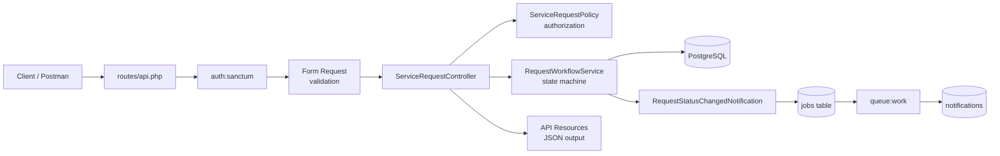

# Architecture

Quantix Service API is a stateless Laravel 13 REST API. A request passes through a fixed pipeline of standard Laravel components. Each layer has one responsibility:

## Main components

| Layer | Location | Responsibility |
|---|---|---|
| Routes | `routes/api.php` | Map URLs to controller actions; everything except `/login` is behind `auth:sanctum` |
| Form Requests | `app/Http/Requests` | Validate input (422 on failure) |
| Controllers | `app/Http/Controllers/API` | Orchestrate: authorize → act → respond |
| Policy | `app/Policies/ServiceRequestPolicy.php` | Decide *who* may perform an action |
| Service | `app/Services/RequestWorkflowService.php` | Decide *whether* a status change is valid, then perform it |
| Models / Enums | `app/Models`, `app/Enums` | Eloquent models; `UserRole` and `RequestStatus` backed enums cast on the models |
| Resources | `app/Http/Resources` | Shape JSON responses |
| Notifications | `app/Notifications` | Queued database notifications |
| Exception handling | `bootstrap/app.php` | Consistent JSON errors for `/api/*` |

## Data model

- `users` → self-reference `manager_id` (employee → manager).
- `service_requests.employee_id` → `users` (owner); `assigned_to` → `users` (Operations owner, nullable).
- `request_comments` and `request_activities` belong to a request (cascade delete) and a user.

## Roles and authorization

- **Employee**: creates, edits and submits their own requests (edit/submit only while `draft` or `returned`).
- **Manager**: sees and decides (approve, reject, return) requests of their direct reports while `submitted`.
- **Operations**: sees requests from `approved` onwards and assigns them. Only the assigned user can start and complete the work.

Every controller action calls `Gate::authorize()`, which resolves to `ServiceRequestPolicy`. The policy checks role, ownership or reporting line, and the current status. Listing is scoped by role in the controller query.

## Workflow and transactions

`RequestWorkflowService::transition()` holds the transition table (`draft→submitted`, `returned→submitted`, `submitted→approved|rejected|returned`, `approved→in_progress`, `in_progress→completed`). Inside a DB transaction it locks the row with `lockForUpdate()`, re-reads the current status, rejects invalid moves with a 422, saves the new status (setting `submitted_at` or `completed_at`) and writes a `request_activities` entry. Assignment uses the same lock-and-recheck pattern in the controller. Two concurrent actions therefore cannot both succeed against a stale status.

## Audit trail

`request_activities` records `created`, `status_changed` and `assigned` events with the actor, from/to status and an optional comment. Entries are written inside the same transaction as the change they describe, and are exposed through `GET /api/requests/{id}/activities`.

## Notifications

`RequestStatusChangedNotification` implements `ShouldQueue` and uses the `database` channel. It is dispatched **after** the transaction commits. Recipients:
- on submit: the manager
- on approve: all Operations users
- on assign: the assignee
- on other changes: the owner

With `QUEUE_CONNECTION=database`, notifications reach the `notifications` table only while `php artisan queue:work` is running.
